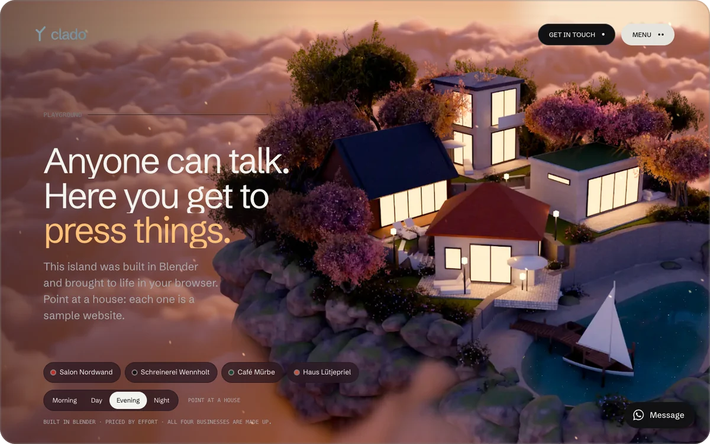

# clado

Websites for small businesses: trades, restaurants and service providers near Ulm, Germany. Built by hand at a fixed price, and the finished site belongs to the customer.

**[cladostudio.com](https://cladostudio.com)** · [Playground](https://cladostudio.com/en/spielplatz)

The name comes from the Greek word **klados**, meaning *branch*.

## What clado builds

- Websites designed for each business, with contact form, legal notice and privacy policy
- Modules such as appointment booking, online ordering, payments and a second language
- Copywriting and Google Business Profile setup
- Hosting, backups, updates and current legal texts as a monthly plan, cancellable any month

## The studio site

[cladostudio.com](https://cladostudio.com) is built with Astro on Cloudflare Workers. The [playground](https://cladostudio.com/en/spielplatz) shows what a browser can do:

- a floating island rendered in Blender that moves in the browser, with wind, drifting clouds and four times of day
- a garden gate configurator in three.js that runs in a Web Worker
- a villa that builds itself pixel by pixel as you scroll

Every page is measured on a 4× throttled CPU: no frame over 20&nbsp;ms. And no third-party servers: no Google Fonts, no CDN, no analytics, no cookie banner.

## Selected client work

- **[WalzWerk Kreativmanufaktur](https://walzwerk-kreativ.de)**: website for a ceramics painting studio near Ulm with its own booking system, online payment and gift vouchers.
- **[Lerntherapie Ulrike Zick](https://www.lernen-zick.de)**: multi-page site for a learning therapy practice, with a contact form protected against spam without captchas or third-party services.

> The source code of the studio site and the client projects is private. This repository is a public showcase.

---

Founded by [Dominik Klossika](https://github.com/dominikk508), run together with [Jannis Dietrich](https://github.com/jannisd07).
